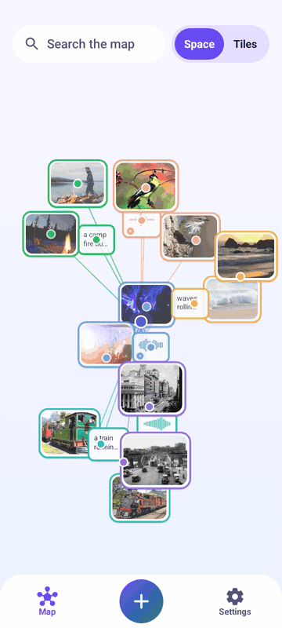
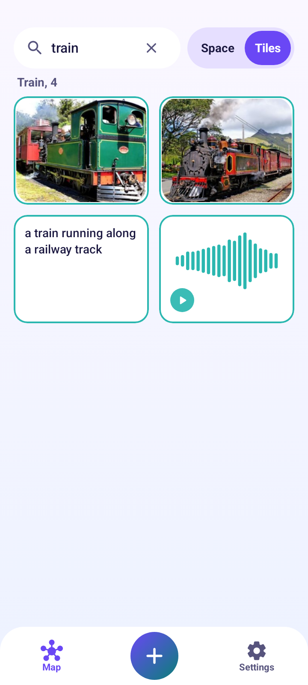

# EmbeddingGemma 2 on Android

Multimodal embeddings on Android, fully on-device. Photos, video frames, audio and text are embedded with EmbeddingGemma 2 and shown together in one interactive 3D map.



| Space | Tiles |
|---|---|
|  |  |

## Features

- One model for all media: EmbeddingGemma 2 (text, vision and audio encoders), run with LiteRT-LM.
- Space view: a 3D map you can rotate, zoom and pan. Similar items sit together.
- Tiles view: type a query and see the best matching cluster as a grid.
- Add photos, videos, audio files, voice notes and text notes. New items are placed on the map or start a new cluster.
- Light and dark themes. A small demo set is included and can be deleted.

## How it works

- 768-d output, cut to 256 dimensions (Matryoshka) and L2-normalised.
- Each media type is centred by its running mean to remove the modality gap.
- The 3D layout is a UMAP written in Kotlin (cosine, 3 components).
- New items go to the weighted average of their 5 nearest neighbours. The layout is refitted every 25 additions.
- Clusters use k-means with k picked by silhouette score. Names come from a 300 word list embedded with the same model.

## Requirements

- JDK 17 and Android SDK platform 35
- Android 12 or newer, 64-bit ARM device (about 8 GB RAM recommended)

## Build

```
./gradlew assembleDebug
```

Install `app/build/outputs/apk/debug/app-debug.apk`.
On first use the app downloads EmbeddingGemma 2 (485 MB, `.litertlm` from `litert-community` on Hugging Face). The demo map works without it.

## Tests

```
./gradlew test
```

The `domain` module is pure Kotlin and holds the vector maths, placement, UMAP and clustering. The `app` module has the Compose UI, Room storage and the LiteRT-LM engine.

## License

Apache 2.0. See `LICENSE`.

EmbeddingGemma 2 and LiteRT-LM are Apache 2.0.
Demo photos and sounds are CC0 or public domain, credited in `app/src/main/assets/demo/demo.json`.
